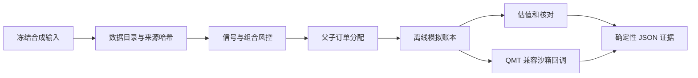

# Vibe Research Trading · 离线研究与执行治理

量化研究平台的脱敏公开作品集，展示从冻结输入、生成信号、订单分配到模拟账本核对的一条可复现链路。维护者：姚权树。本项目借助 Codex 等 AI 编程工具开发和整理，保留上游项目署名，不将上游成果归为个人原创。

这是从本地 `vibe_research_trading` 整理出的**可运行离线核心版**。它包含 52 个 `quant_core` 模块及必要的契约、演示和回归测试；完整前后端、运维控制台、私有研究档案与在线接入不属于本次发行范围。部分支持模块保留了完整原始实现，但本仓库的验收范围限于下述离线入口；不能据此认定其他内部接口均已独立集成。

## 可以复现什么

- 内容寻址的数据版本、输入哈希和执行证据，重复执行不重复记账。
- 策略信号 → 子策略意图 → 父订单分配 → 模拟成交 → 后续估值与账本核对。
- 独立的执行语义比较，保留不同实现之间的失败项，不强行报告全通过。
- `QMT_COMPAT_SANDBOX` 中的重复、乱序、取消、拒绝、断线和重启回调演练。
- 严格 JSON、固定夹具哈希、禁止演示升级为正式证据，以及临时工作区清理。



## 快速运行

Python 3.12 或以上，在仓库根目录运行。演示使用标准库；安装测试依赖后还会交叉验证 JSON Schema。

```bash
python -B scripts/offline-paper-demo.py
python -B scripts/offline-paper-demo.py --broker QMT_COMPAT_SANDBOX
```

每个命令输出一行 JSON。成功时 `ok` 为 `true`，`workspace_cleaned` 为 `true`，`network_accessed` 和 `real_orders` 均为 `false`。演示会在系统临时目录中创建并清理独立工作区。

```bash
python -m venv .venv
# Windows: .venv\Scripts\activate
# Linux/macOS: source .venv/bin/activate
python -m pip install -r requirements-dev.txt
python -B -m pytest -q -p no:cacheprovider tests research/strategy_lab/test
```

本次公开候选版在 Windows 的 Python 3.12 环境验证，其他平台尚未验证。完整测试结果与公开副本的适配说明见 [VALIDATION.md](docs/VALIDATION.md)。

## 如何解读结果

示例中的 100000 初始现金、证券代码和价格路径均用于合成演示。默认路径会得到两笔模拟成交，后续估值权益 96500、浮动损益 -3500；这些数值是夹具设计的结果，**不是历史回测或实盘收益**。

`adapter_reproduction_all_passed` 只表示兼容层复现了比较结果，不表示两种执行引擎都通过所有语义检查。`authority_mapping`、`promotion_eligible`、`formal_forward_evidence` 始终为 `false`。QMT 沙箱没有加载 `xtquant`，没有连接真实券商，也没有获得 QMT 厂商认证。

日历是冻结的三交易日合成样本，不是交易所日历。成本和交易规则配置仅是本项目保存的研究假设，本仓库不验证其时效性或用于实际下单的适用性。部分研究接口需要未发行的完整平台组件，调用时会明确失败；离线演示不使用它们。

## 目录

| 路径 | 内容 |
| --- | --- |
| `apps/Vibe-Research/backend/quant_core/` | 所需核心模块的依赖闭包与精简导出 |
| `research/strategy_lab/` | 离线演示、严格 JSON 与固定合成夹具 |
| `research/platform-native-strategy/tools/` | 从夹具解码的冻结执行模型，便于审查 |
| `config/` | 本次演示所需的 JSON 契约及研究策略配置 |
| `scripts/` | 离线演示入口与执行语义检查工具 |
| `tests/`、`research/strategy_lab/test/` | 离线回归测试 |

## 来源和贡献边界

完整本地平台参考并集成了 [simonlin1212/Vibe-Research](https://github.com/simonlin1212/Vibe-Research) 与 [simonlin1212/TradingAgents-astock](https://github.com/simonlin1212/TradingAgents-astock)。本公开版不包含 TradingAgents 引擎及其代码，也不包含 Vibe-Research 的完整应用。

公开内容侧重项目中关于数据与研究证据治理、模拟执行语义、组合风险、父子订单分配、持久化和离线沙箱验证的工作。个人经历表述应使用“在上游基础上集成与扩展，借助 AI 工具完成开发与验证”，不应使用“独立原创完整量化平台”。保留的第三方代码与原始版权声明见 [apps/Vibe-Research/LICENSE](apps/Vibe-Research/LICENSE)；更多说明见 [RIGHTS.md](RIGHTS.md)。

本仓库不含真实账户、凭据、持仓、交易流水、商业行情数据、私有研究结果、数据库或旧 Git 历史。
